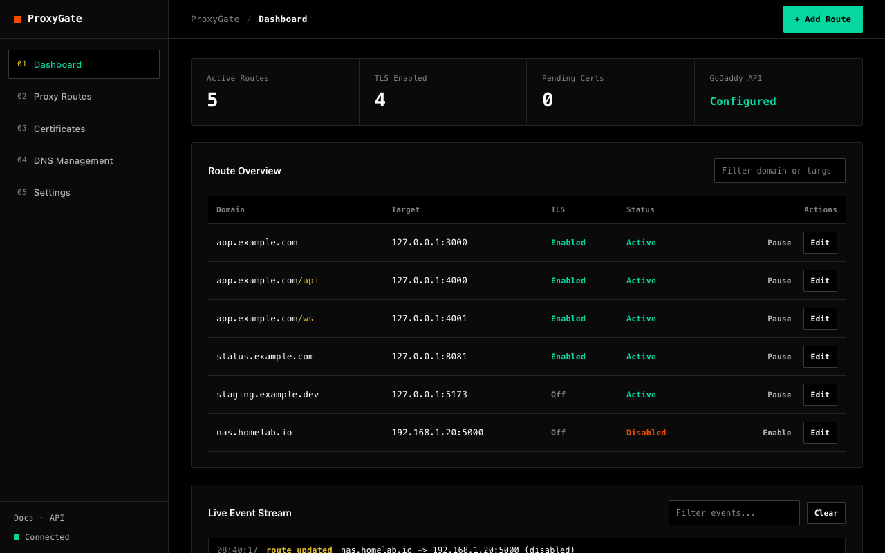
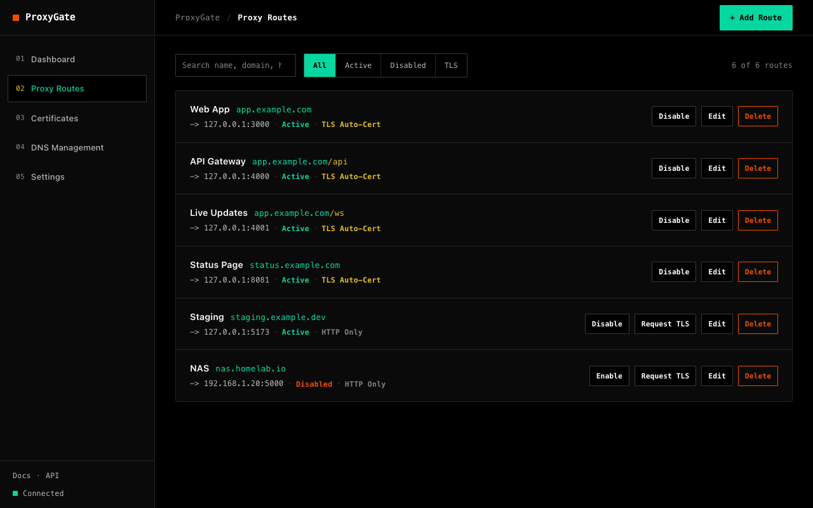

# ProxyGate

[](https://github.com/gcis/proxygate/actions/workflows/ci.yml)
[](https://codecov.io/gh/gcis/proxygate)
[](https://gcis.github.io/proxygate/)

A lightweight, self-hosted reverse proxy with a built-in web UI for managing routes, TLS certificates (Let's Encrypt), and DNS records (GoDaddy).

## Documentation

Full docs: <https://gcis.github.io/proxygate/>

> **DISCLAIMER: This software is provided for educational and development purposes. It has not been through a formal security audit. Do not use in production environments without thorough review. See [Security Considerations](#security-considerations).**

## Features

- **Reverse Proxy** — Route HTTP/HTTPS/WebSocket traffic by domain name to local services
- **Web Dashboard** — Manage everything through a clean, modern UI
- **Let's Encrypt Integration** — Request free TLS certificates via DNS-01 challenge with step-by-step UI guidance
- **Automatic Certificate Renewal** — Background daily check; certs are renewed 30 days before expiry and hot-reloaded with no restart
- **GoDaddy DNS Management** — Create/manage DNS records directly from the UI with API key integration
- **Automatic DNS + Cert** — One-click: create DNS record via GoDaddy, verify, and install certificate
- **Config Encryption** — AES-256-GCM encryption for sensitive config fields (GoDaddy credentials, ACME email) at rest; key supplied via environment variable
- **Live Reload** — WebSocket-powered real-time updates across all UI components
- **Hot Config Reload** — Change routes without restarting the proxy
- **Admin Network Whitelist** — Restrict admin UI access by IP/CIDR, configurable via CLI or UI
- **Single Binary** — No external dependencies, UI embedded in the Go binary

## Screenshots

| Dashboard | Route Management |
|-----------|-----------------|
|  |  |

## Quick Start

### Build and Run

```bash
git clone https://github.com/gcis/proxygate.git
cd proxygate
make build
./bin/proxygate
```

The admin UI will be available at `http://127.0.0.1:9090`. On first start it is locked: open it and enter the one-time setup code from `data/setup-code`, then choose a password. If you lose the password, run `./bin/proxygate passwd` on the machine. See [Security](https://gcis.github.io/proxygate/security.html).

### With Network Whitelist

Restrict admin UI access to specific networks from the command line:

```bash
./bin/proxygate --allow-network 192.168.1.0/24 --allow-network 10.0.0.0/8
```

The flag can be repeated and is saved to the config. If omitted, the admin UI defaults to localhost only (`127.0.0.0/8`, `::1/128`). Networks can also be configured in the JSON config or through the Settings page in the UI.

The admin UI listens on `127.0.0.1` by default, so to reach it from another machine also set `"admin_host": "0.0.0.0"` (or the machine's LAN address) in the config. The admin UI also requires a password; for HTTPS and stricter login rules see the [security guide](https://gcis.github.io/proxygate/security.html#advanced).

### Using Go directly

```bash
go run ./cmd/proxygate/
```

### Configuration

ProxyGate uses a JSON configuration file (default: `./data/proxygate.json`). It's created automatically on first run with sensible defaults:

```bash
./bin/proxygate --config /path/to/config.json
```

Default ports (new install):
| Service | Port | Description |
|---------|------|-------------|
| HTTP Proxy | 8080 | Incoming HTTP traffic (change to 80 in config for production) |
| HTTPS Proxy | 8443 | Incoming HTTPS traffic (change to 443 in config for production) |
| Admin UI | 9090 | Management dashboard (localhost only) |

> Ports 80 and 443 require `CAP_NET_BIND_SERVICE`. See **[docs/deployment.md](docs/deployment.md)** for the recommended approaches (systemd `AmbientCapabilities`, `setcap`, reverse proxy, or container capabilities).

## Usage Guide

### 1. Adding a Proxy Route

1. Open the Admin UI at `http://127.0.0.1:9090`
2. Navigate to **Proxy Routes**
3. Click **+ Add Route**
4. Fill in:
   - **Domain**: The hostname to match (e.g., `app.example.com`)
   - **Target Host**: Where to forward traffic (e.g., `127.0.0.1`)
   - **Target Port**: The port of your local service (e.g., `3000`)
5. Click **Save**

The route is active immediately — no restart needed.

### 2. Setting Up Let's Encrypt TLS

1. Go to **Settings** and configure your ACME email
2. Navigate to **Certificates**
3. Enter your domain and click **Request Certificate**
4. You'll see a DNS TXT record to create:
   - **Name**: `_acme-challenge.yourdomain.com`
   - **Value**: A verification token
5. Create this record with your DNS provider (or use auto-DNS with GoDaddy)
6. Click **Verify & Complete**
7. The certificate is automatically installed and the route is updated

### 3. GoDaddy DNS Integration

1. Go to **DNS Management**
2. Enter your GoDaddy API Key and Secret ([get them here](https://developer.godaddy.com/keys))
3. Click **Test Connection** to verify
4. You can now:
   - Browse your domains and DNS records
   - Create A, CNAME, and TXT records from the UI
   - Enable **Auto-DNS** when requesting certificates for automatic record creation

### 4. Automatic Certificate Flow

With GoDaddy configured, the entire certificate flow is automated:

1. Request a certificate for a domain
2. Check **Auto-create DNS record via GoDaddy**
3. Click **Request Certificate** → the DNS record is created automatically
4. Click **Verify & Complete** → certificate is fetched and installed
5. The proxy route is updated with TLS — all automatically

## Architecture

```
┌─────────────────────────────────────────┐
│                ProxyGate                │
├─────────────┬─────────────┬─────────────┤
│  HTTP :80   │ HTTPS :443  │ Admin :9090 │
├─────────────┴─────────────┤             │
│     Reverse Proxy Engine  │  REST API   │
│  ┌──────┐ ┌──────┐       │  WebSocket  │
│  │Route1│ │Route2│ ...   │  Static UI  │
│  └──┬───┘ └──┬───┘       │             │
│     ▼        ▼            │             │
│  :3000    :8080    ...   │             │
├───────────────────────────┤             │
│  Config Manager (hot reload)            │
│  ACME Client (Let's Encrypt)            │
│  GoDaddy DNS Client                     │
└─────────────────────────────────────────┘
```

## Configuration Reference

```json
{
  "server": {
    "http_port": 8080,
    "https_port": 8443,
    "admin_port": 9090,
    "admin_host": "127.0.0.1",
    "allowed_networks": ["127.0.0.0/8", "::1/128"]
  },
  "routes": [
    {
      "id": "route_1",
      "name": "My App",
      "domain": "app.example.com",
      "target_host": "127.0.0.1",
      "target_port": 3000,
      "tls_enabled": false,
      "enabled": true
    }
  ],
  "godaddy": {
    "api_key": "",
    "api_secret": "",
    "base_url": "https://api.godaddy.com"
  },
  "acme": {
    "email": "admin@example.com",
    "directory": "https://acme-v02.api.letsencrypt.org/directory",
    "cert_dir": "./certs",
    "use_staging": true
  }
}
```

## Configuration Encryption

The sensitive fields `godaddy.api_key`, `godaddy.api_secret` and `acme.email` are stored encrypted (AES-256-GCM, prefixed `enc:` on disk). In memory they are plaintext.

| Situation | Result |
|-----------|--------|
| `PROXYGATE_CONFIG_KEY` set (64 hex characters) | That key is used |
| Not set | `data/secret.key` (mode 0600) is created on first use and used |
| Plaintext values in an existing config | Encrypted on the next start |
| Key missing or wrong | ProxyGate starts and serves all routes; the affected fields are treated as empty, kept unchanged on disk, and reported in the admin UI |
| `"security": { "encrypt_secrets": false }` | Stored in plaintext |

Set `PROXYGATE_CONFIG_KEY` from your service manager (for example a systemd `EnvironmentFile` with mode 0600) if you don't want the key next to the config.

**Changing the key:** values encrypted with the old key cannot be read with a new one. After switching keys, re-enter the GoDaddy credentials and ACME email in the admin UI.

---

## Automatic Certificate Renewal

ProxyGate runs a background goroutine that checks all TLS-enabled routes **daily** (immediately on startup, then every 24 hours). When a certificate has fewer than **30 days** of validity remaining, the full ACME DNS-01 flow is triggered automatically and the new certificate is hot-reloaded into the proxy without restarting any listener.

### What happens on renewal

1. `certmanager` detects expiry < 30 days via the cert's `NotAfter` field.
2. A new DNS-01 challenge is issued via the ACME client.
3. The `_acme-challenge` TXT record is published through GoDaddy, so renewal needs GoDaddy credentials; without them it fails and is logged. The record is left in the zone afterwards.
4. The new cert and key are written atomically (write-to-temp + rename).
5. The proxy engine hot-reloads the cert in memory — no port 80/443 rebind needed.

### On failure

Renewal errors are logged at `ERROR` level and include the domain name. The manager **continues checking other domains** — one failure does not block the rest. Metrics counters (`RenewalSuccess`, `RenewalFailed`) are exposed and can be scraped.

### Override / manual renewal

Use the admin UI **Certificates** page to trigger a manual certificate request at any time. The certmanager's in-flight dedup ensures concurrent manual + automatic renewals for the same domain are coalesced.

---

## Deployment

For full production deployment instructions — systemd with `AmbientCapabilities`,
`setcap`, reverse proxy (nginx/Caddy), and container (Docker/k8s) options — see
**[docs/deployment.md](docs/deployment.md)**.

### Quick systemd install

```bash
# Build
make build

# Install binary and create service user
sudo cp bin/proxygate /opt/proxygate/proxygate
sudo useradd --system --no-create-home --shell /usr/sbin/nologin proxygate
sudo mkdir -p /opt/proxygate/{data,certs}
sudo chown -R proxygate:proxygate /opt/proxygate

# Install unit file (already has AmbientCapabilities=CAP_NET_BIND_SERVICE)
sudo cp examples/systemd/proxygate.service /etc/systemd/system/
sudo systemctl daemon-reload
sudo systemctl enable --now proxygate
```

The unit file runs ProxyGate as the `proxygate` user with `CAP_NET_BIND_SERVICE`,
so it can bind ports 80/443 **without root**.

### Running on Port 80/443 without systemd

```bash
sudo setcap 'cap_net_bind_service=+ep' ./bin/proxygate
```

**Re-run `setcap` after every build** — capabilities are stored on the binary file,
not in source. See [docs/deployment.md](docs/deployment.md) for details.

## Security Considerations

By default the admin UI requires a password (set on first start with a one-time code, recoverable with `proxygate passwd`), listens on `127.0.0.1`, accepts only allowlisted networks, rejects cross-site requests, and stores the GoDaddy credentials encrypted. Scripts use API tokens (`proxygate token create`).

HTTPS for the admin UI, refusing logins over plain HTTP, session lifetimes and strong password rules are opt-in settings. The [security guide](https://gcis.github.io/proxygate/security.html) covers the threat model, every setting, suggested hardening and the roadmap. To report a vulnerability, see [SECURITY.md](SECURITY.md).

Keep in mind:

- **GoDaddy API keys** cover the whole GoDaddy account; scope them to what you are comfortable with.
- **TLS private keys and the ACME account key** in `certs/` are plain files readable only by the service user; back them up and protect them like any web server's keys.
- **No independent security audit** has been done.

## API Reference

All endpoints are prefixed with `/api` and, except the public `/api/auth/*` ones, require a signed-in session or `Authorization: Bearer <token>`.

| Method | Path | Description |
|--------|------|-------------|
| GET | `/api/auth/status` | Setup and sign-in state (public) |
| POST | `/api/auth/setup` | Set the first password with the setup code (public) |
| POST | `/api/auth/login` | Sign in (public) |
| POST | `/api/auth/logout` | Sign out |
| POST | `/api/auth/password` | Change the admin password |
| GET | `/api/config` | Get current configuration |
| PUT | `/api/config/server` | Update server config (partial; returns `restart_required`) |
| GET | `/api/security/status` | Encryption, CSP, rate-limit and allowlist posture |
| GET | `/api/routes` | List all routes |
| POST | `/api/routes` | Create a route |
| GET | `/api/routes/{id}` | Get a specific route |
| PUT | `/api/routes/{id}` | Update a route (partial merge) |
| PATCH | `/api/routes/{id}/toggle` | Enable/disable a route |
| DELETE | `/api/routes/{id}` | Delete a route |
| GET | `/api/status` | Get proxy status |
| POST | `/api/acme/request` | Request a certificate |
| POST | `/api/acme/complete` | Complete certificate verification |
| GET | `/api/acme/challenges` | List active ACME challenges |
| PUT | `/api/acme/config` | Update ACME settings |
| PUT | `/api/godaddy/config` | Update GoDaddy credentials |
| POST | `/api/godaddy/verify` | Test GoDaddy connection |
| GET | `/api/godaddy/domains` | List active GoDaddy domains (`?include_inactive=true` for all) |
| GET | `/api/godaddy/domains/{d}/records` | List DNS records |
| POST | `/api/godaddy/domains/{d}/records` | Create DNS record |
| DELETE | `/api/godaddy/domains/{d}/records/{type}/{name}` | Delete DNS record |
| POST | `/api/godaddy/auto-dns` | Auto-create DNS record |
| GET | `/api/certs/status` | Certificate expiry and renewal metrics |
| GET | `/ws` | WebSocket for live updates |

## License

MIT License. See [LICENSE](LICENSE) for details.
